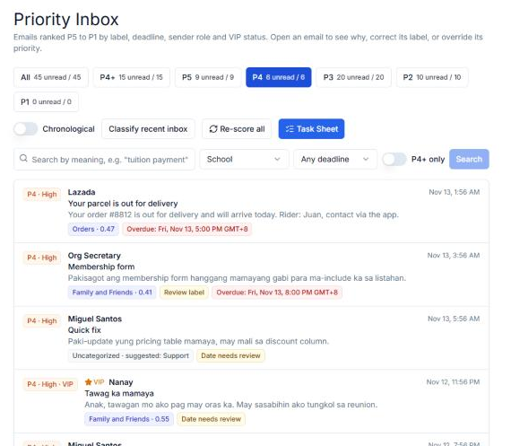
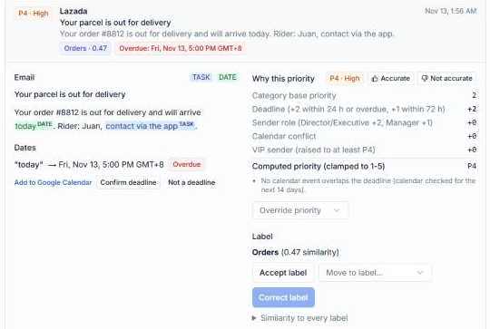
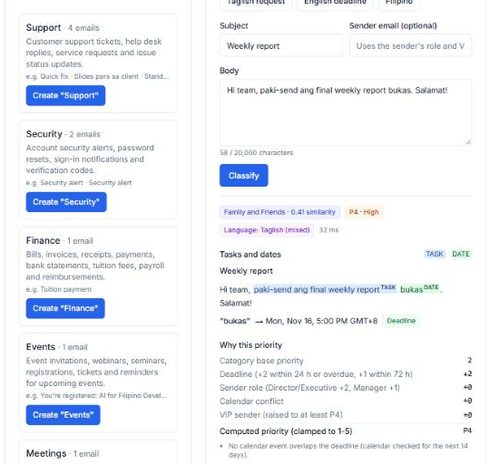
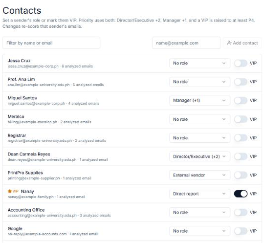
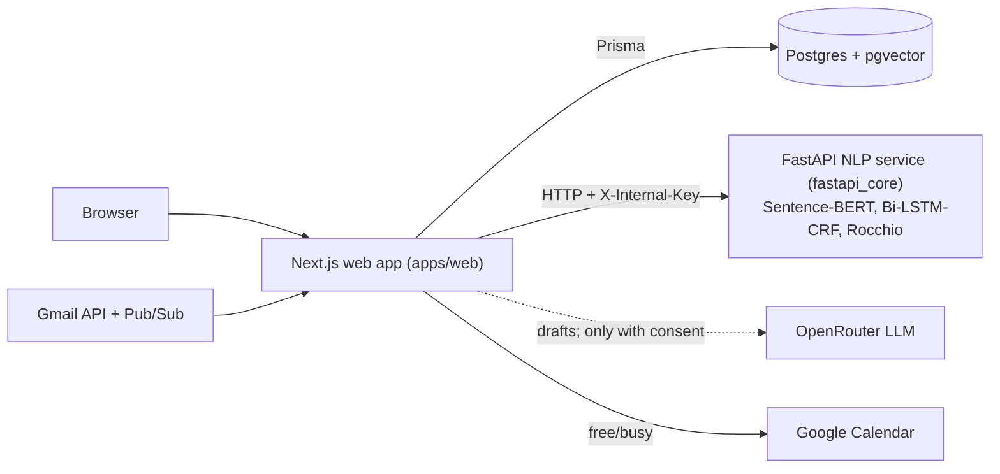

# CategorAIze

A bilingual (English, Filipino, Taglish) email classification and
prioritization system, built as a capstone on a fork of
[Inbox Zero](https://github.com/elie222/inbox-zero). The fork's LLM calls for
classification are replaced by three local algorithms:

| Algorithm | What it does | Where |
| --- | --- | --- |
| **Multilingual Sentence-BERT** (`paraphrase-multilingual-MiniLM-L12-v2`) | Matches each email to your labels and rules by meaning; suggests a new label from a fixed library when nothing fits; semantic search; extractive summaries | `fastapi_core/app/algorithms/classifier.py`, `rule_matcher.py`, `fastapi_core/app/nlp/summarizer.py` |
| **Bi-LSTM-CRF** sequence tagger | Finds TASK and DATE spans ("paki-send ang report **bukas**") and resolves deadlines in your time zone | `fastapi_core/app/algorithms/sequence_tagger.py` |
| **Rocchio** relevance feedback | Each label correction moves the label's centroid toward the email (and away from the wrong label), so later emails are classified better | `fastapi_core/app/algorithms/feedback.py` |

Priority **P1 to P5** is computed by deterministic rules on top of these: the
label's base priority, the deadline (+2 within 24 h or overdue, +1 within
72 h), the sender's role (Director/Executive +2, Manager +1), your calendar (+1
when the deadline falls in a busy period) and VIP (at least P4). Every email
shows its factor breakdown.

Drafted replies stay on an external LLM (OpenRouter). They run only after the
user turns on external AI processing in Settings; it is **off by default**.
When the local model is unsure about a rule match or a Reply Zero status, the
app asks the external LLM only with that consent; otherwise it keeps the local
answer. The assistant chat (in the app and through Telegram) is a
separate feature the user opens on purpose; it always uses the external LLM
and is not gated by this setting.

## Screenshots

| Priority Inbox | Why this priority |
| --- | --- |
|  |  |
| **Label Studio** | **Contacts** |
|  |  |

## Architecture



The NLP service is stateless: the web app sends the email text, your labels
(with their centroids), the sender's role and your busy periods (start and end
times only), and stores the result. No account tokens reach the service.

## Run it on Windows

You need: **Docker Desktop**, **Node 24** with `corepack enable` (pnpm),
**Python 3.11 or 3.12**, and a **Google Cloud OAuth client** (Gmail API and
Calendar API enabled; your Google account added as a test user; redirect URIs
`http://localhost:3000/api/auth/callback/google` and
`http://localhost:3000/api/google/calendar/callback`).

1. Install the web app's packages (from the repo root):

   ```powershell
   pnpm install
   ```

2. Create `apps\web\.env` from `apps\web\.env.example`. Besides the usual
   Inbox Zero values (`DATABASE_URL`, `AUTH_SECRET`, `EMAIL_ENCRYPT_SECRET`,
   `EMAIL_ENCRYPT_SALT`, `INTERNAL_API_KEY`, `GOOGLE_CLIENT_ID`,
   `GOOGLE_CLIENT_SECRET`, `REDIS_HTTP_URL`, `REDIS_HTTP_TOKEN`), set:

   ```ini
   CATEGORAIZE_ENABLED=true
   CATEGORAIZE_SERVICE_URL=http://127.0.0.1:8000
   CATEGORAIZE_INTERNAL_KEY=<any long random string>
   ```

   Optional: `OPENROUTER_API_KEY` for drafts. Never commit `.env`.

3. Create the NLP service's Python environment (CPU-only PyTorch):

   ```powershell
   cd fastapi_core
   py -3.12 -m venv .venv
   .\.venv\Scripts\python.exe -m pip install torch --index-url https://download.pytorch.org/whl/cpu
   .\.venv\Scripts\python.exe -m pip install -r requirements-dev.txt
   cd ..
   ```

4. Start everything. The script starts Postgres and Redis in Docker, the NLP
   service on port 8000, applies any pending database migrations and starts
   the web app on port 3000. It skips anything that is already running. The
   first start downloads the model (about 470 MB). Logs go to
   `%TEMP%\categoraize`.

   ```powershell
   powershell -ExecutionPolicy Bypass -File scripts\categoraize\start.ps1
   ```

5. Open http://localhost:3000, sign in with Google, then load the demo data
   (45 bilingual emails, labels, contacts) into your account:

   ```powershell
   cd apps\web
   pnpm categoraize:seed -- --email you@example.com
   ```

   Real mail is never changed; `--reset` replaces only previously seeded emails.

## Demo

Run the five acceptance scenarios against the live service (needs only the
NLP service: `start.ps1 -SkipWeb` is enough):

```powershell
powershell -ExecutionPolicy Bypass -File scripts\categoraize\demo.ps1
```

It prints each email, what the service returned and PASS or FAIL:

1. An existing label is selected by Sentence-BERT (English and Filipino).
2. An unmatched email gets a suggested label ("Jobs") that needs your click.
3. "Hi team, paki-send ang final weekly report bukas" gives a TASK span, a
   DATE span and a deadline of the next day, 17:00 Manila.
4. The same email with "tomorrow" goes from P3 to P4, and to P5 when the
   calendar is busy at the deadline, with the factor breakdown.
5. Three Rocchio corrections flip a later tuition email from School to
   Bills and Payments.

In the app: **Priority Inbox** (ranking, filters, search in English or
Filipino, Task Sheet), click an email for its spans and factor breakdown,
correct a label or priority, then **Re-score all**. **Label Studio** shows
suggested labels; **Contacts** sets roles and VIPs; after three manual
priority changes in the same direction, the inbox suggests a change.

## Feature switches

All default to on when `CATEGORAIZE_ENABLED=true`. Set one to `false` to send
that feature back to the original LLM path:
`CATEGORAIZE_RULE_MATCHING`, `CATEGORAIZE_SMART_CATEGORIES`,
`CATEGORAIZE_COLD_EMAIL`, `CATEGORAIZE_SUMMARIES`, `CATEGORAIZE_REPLY_STATUS`.
With `CATEGORAIZE_ENABLED` unset the app behaves like the original Inbox Zero.

## Results

Measured on held-out test sets that were never used for training or tuning
(synthetic and team-written data only; no real user mail is used for
training):

| Task | Score | Baseline |
| --- | --- | --- |
| TASK/DATE extraction (entity F1), held-out set | 0.863 | regex 0.767 |
| TASK/DATE extraction, LLM-generated held-out set | 0.858 | regex 0.655 |
| TASK/DATE extraction, Filipino subset | 0.875 | |
| Rule matching accuracy, local only | 0.792 | |
| Rule matching, confident local answers (53% of emails) | 0.941 | |
| Reply Zero status | 0.917 | |

The team's own hand-labeled test set is still to be scored. Training and
evaluation scripts are in `fastapi_core/training/`; see
[`fastapi_core/README.md`](fastapi_core/README.md).

## Tests

```powershell
cd fastapi_core; .\.venv\Scripts\python.exe -m pytest      # service, incl. scenarios 1-5
cd apps\web; pnpm test -- --run utils/categoraize          # web app CategorAIze units
```

## Known limitations

- Tested with Gmail and Google Calendar only. Outlook and Outlook Calendar
  come from the original code but have not been tested with CategorAIze.
- A copyright line in a footer ("© 2026") can be read as a date.
- Security and privacy hardening from the PRD (field encryption, row-level
  security, Terms and Privacy pages) is deferred past this build.

## Credits and license

CategorAIze is a fork of [Inbox Zero](https://github.com/elie222/inbox-zero)
by Elie Steinbock and contributors, and is licensed under the same
[AGPL-3.0](LICENSE). The original README follows.

---

[](https://www.getinboxzero.com)

<p align="center">
  <a href="https://www.getinboxzero.com">
    <h1 align="center">Inbox Zero - your 24/7 AI email assistant and email app</h1>
  </a>
  <p align="center">
    Organizes your inbox, pre-drafts replies, manages your calendar, and organizes attachments. Chat with it from Slack or Telegram to manage your inbox on the go. Open source alternative to Fyxer, but more customizable and secure. We also offer an email app, an open source alternative to Superhuman.
    <br />
    <a href="https://www.getinboxzero.com">Website</a>
    ·
    <a href="https://www.getinboxzero.com/discord">Discord</a>
    ·
    <a href="https://github.com/elie222/inbox-zero/issues">Issues</a>
  </p>
</p>

<div align="center">


<a href="https://trendshift.io/repositories/6400" target="_blank"></a>

[](https://vercel.com/oss)

</div>

## Mission

To help you spend less time in your inbox, so you can focus on what matters most.

## Features

Inbox Zero has two parts: an AI email assistant that works in the background on your Gmail or Outlook account, and an email client. Each works on its own.

### AI email assistant

- **AI Personal Assistant:** Organizes your inbox and pre-drafts replies in your tone and style.
- **AI Rules for email:** Explain in plain English how your AI should handle your inbox.
- **Reply Zero:** Track emails to reply to and those awaiting responses.
- **Bulk Unsubscriber:** One-click unsubscribe and archive emails you never read.
- **Bulk Archiver:** Clean up your inbox by bulk archiving old emails.
- **Cold Email Blocker:** Auto‑block cold emails.
- **Email Analytics:** Track your activity and trends over time.
- **Meeting Briefs:** Get personalized briefings before every meeting, pulling context from your email and calendar.
- **Smart Filing:** Automatically save email attachments to Google Drive or OneDrive.
- **Slack & Telegram Integration:** Chat with your AI assistant from Slack or Telegram to manage your inbox without leaving the apps you already use.

### Email client

A fast email client for Gmail and Outlook, with a split inbox, all your accounts in one place, and team comments.

- **Web and desktop:** open source. The desktop app is Electron, in [`apps/desktop`](apps/desktop).
- **iOS:** a native Swift app, not open source yet. The [App Store app](https://www.getinboxzero.com/app) can connect to your own server URL if you self-host.
- **Android:** an older React Native [Android app](https://www.getinboxzero.com/android).

Learn more in our [docs](https://docs.getinboxzero.com).

## Demo

[](https://player.mux.com/YeTrweHxCIM5tcBMXlvRbmDuPqL028lJrmJ3F6ZgwnDY)

## Built with

- [Next.js](https://nextjs.org/)
- [Tailwind CSS](https://tailwindcss.com/)
- [shadcn/ui](https://ui.shadcn.com/)
- [Prisma](https://www.prisma.io/)
- [Upstash](https://upstash.com/)
- [Turborepo](https://turbo.build/)
- [Popsy Illustrations](https://popsy.co/)

## Star History

[](https://www.star-history.com/#elie222/inbox-zero&Date)

## Feature Requests

To request a feature open a [GitHub issue](https://github.com/elie222/inbox-zero/issues), or join our [Discord](https://www.getinboxzero.com/discord).

## Getting Started

We offer a hosted version of Inbox Zero at [getinboxzero.com](https://www.getinboxzero.com).

### Self-Hosting

The fastest way to self-host Inbox Zero is with the CLI:

> **Prerequisites**: [Docker](https://docs.docker.com/engine/install/) and [Node.js](https://nodejs.org/) v24+

```bash
npx @inbox-zero/cli setup      # One-time setup wizard
npx @inbox-zero/cli start      # Start containers
```

Open http://localhost:3000

For complete self-hosting instructions, production deployment, OAuth setup, and configuration options, see our **[Self-Hosting Docs](https://docs.getinboxzero.com/hosting/quick-start)**.

### Local Development

> **Prerequisites**: macOS or Linux (WSL on Windows), [Node.js](https://nodejs.org/) v24, and the pnpm version pinned in `package.json`. Install either [Docker Desktop](https://docs.docker.com/desktop/) with Compose or native PostgreSQL and Redis. On macOS, native services can be installed with `brew install postgresql@16 redis`.

```bash
git clone https://github.com/elie222/inbox-zero.git
cd inbox-zero
pnpm install
pnpm local:start
```

Open http://localhost:3000/mail and sign in with Google as `developer@example.com`, or Microsoft as `developer@outlook.test`. The Google mailbox contains demo messages. Demo users have onboarding completed, and premium checks are bypassed for local development.

The command starts an isolated database, Redis and its HTTP endpoint, both mail-provider emulators, billing and email-delivery emulators, an LLM emulator, and Next.js. It applies migrations and waits for services to become ready. No OAuth credentials or AI API keys are required. AI responses are canned; this mode exercises application flows, not model quality.

Existing `.env` files are left unchanged and ignored by this launcher. Generated credentials, seed data, and the current service addresses are stored under `.context/local-dev/`. Native database data stays there; Docker database data stays in a volume unique to the checkout. Restarts preserve database data and credentials. Redis caches and provider/emulator state start fresh on each run.

Press **Ctrl-C** to stop the app and the services this command started. Start it again with the same command. If port 3000 is occupied, use `pnpm local:start --port 3001`. Native PostgreSQL and Redis are selected when available; use `--backend docker` or `--backend native` to select explicitly. A checkout-specific loopback port prevents concurrent launchers; the operating system releases that lock after a crash, and stale PID files are replaced automatically. Services use automatically assigned ports, so existing databases and Redis instances are not reused or stopped.

Run `pnpm local:start --help` for options. If an unrelated process occupies the reported lock port, stop that process or use a different checkout location. PostgreSQL data must be opened with the same major version that created it. If you upgrade your native PostgreSQL major version, back up or move `.context/local-dev/postgres` before starting a new cluster.

For development against real providers, continue to use `pnpm setup`, your own environment files, and `pnpm dev`. See the **[Contributing Guide](https://docs.getinboxzero.com/contributing)** for configuration and devcontainer setup.

## Contributing

View open tasks in [GitHub Issues](https://github.com/elie222/inbox-zero/issues) and join our [Discord](https://www.getinboxzero.com/discord) to discuss what's being worked on.

Docker images are automatically built on every push to `main` and tagged with the commit SHA (e.g., `elie222/inbox-zero:abc1234`). The `latest` tag always points to the most recent main build. Formal releases are tagged with the version number without the `v` prefix (e.g., git tag `v2.30.0` → `ghcr.io/elie222/inbox-zero:2.30.0`), plus a minor alias (e.g., `2.30`).
