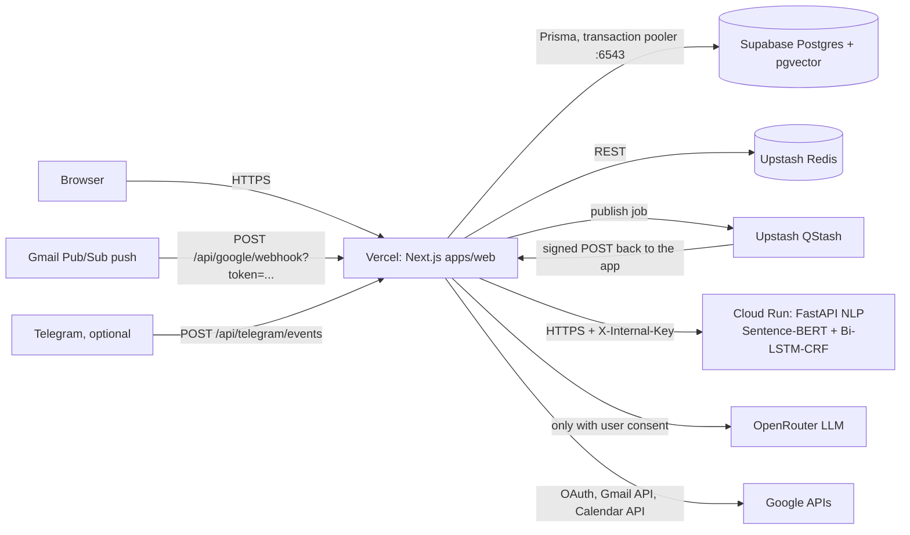

# CategorAIze deployment plan

Status: plan only. Nothing here has been deployed, and no accounts or cloud
settings have been created or changed. Written 2026-11-15, two days before the
capstone deadline. Prices and limits were checked on the web on 2026-11-15
(sources at the end); anything marked **(unverified)** could not be confirmed
on an official page and should be checked in the provider's console before you
rely on it.

## 1. Target architecture

| Piece | Host | Plan for the demo |
| --- | --- | --- |
| Next.js web app (`apps/web`) | Vercel | Hobby (non-commercial use is fine for a capstone) |
| PostgreSQL + pgvector | Supabase | Free |
| HTTP Redis (cache, rate limits) | Upstash Redis | Free |
| Background jobs (queue) | Upstash QStash | Free |
| FastAPI NLP service (`fastapi_core`) | **Google Cloud Run** (fallback: Render Standard) | Free tier, with one warm instance on demo day |
| Drafts (external LLM, opt-in consent) | OpenRouter | Pay as you go |
| Gmail, Calendar, Pub/Sub | Google Cloud (the project that already holds the OAuth client) | Free |



What the code actually needs (from `apps/web/env.ts`, `apps/web/.env.example`,
`apps/web/utils/queue/*`):

- **Redis:** the app talks to Redis over the Upstash REST protocol:
  `REDIS_HTTP_URL` / `REDIS_HTTP_TOKEN`, which also accept the names
  `UPSTASH_REDIS_REST_URL` / `UPSTASH_REDIS_REST_TOKEN` (and Vercel KV's
  `KV_REST_API_*`). `REDIS_URL` (TCP `rediss://`) is only for BullMQ and
  subscriptions; leave it unset on Vercel.
- **Queue:** `getQueueBackend()` returns `QUEUE_BACKEND` if set, otherwise
  `qstash` when `QSTASH_TOKEN` is set, otherwise `internal`. `internal` makes
  the app fire a background `fetch` to its own URL, which a serverless function
  may cut off once the response is sent. **Use QStash**: set `QSTASH_TOKEN`,
  `QSTASH_CURRENT_SIGNING_KEY`, `QSTASH_NEXT_SIGNING_KEY` and leave
  `QUEUE_BACKEND` empty (or set it to `qstash`).
- **NLP service:** `CATEGORAIZE_SERVICE_URL` + `CATEGORAIZE_INTERNAL_KEY` (same
  value on both sides). The web client times out after **20 s** per request and
  **3 s** for `/healthz` (`apps/web/utils/categoraize/client.ts`). That matters
  for cold starts (section 2).

Region: put everything near the users (Philippines). Suggested: Vercel
functions in `sin1` (Singapore), Supabase in `ap-southeast-1` (Singapore),
Upstash in Singapore if offered, Cloud Run in `asia-southeast1` (Singapore).
Note that `cloudbuild.yaml` in the repo uses `asia-southeast3`; check that this
region exists and offers Cloud Run for your project **(unverified)**, or use
`asia-southeast1`.

## 2. Where to host the FastAPI NLP service

Requirements: CPU only; about 1.5–2 GB RAM; loads a ~470 MB Sentence-BERT
model (`paraphrase-multilingual-MiniLM-L12-v2`, baked into the image by
`fastapi_core/Dockerfile`) plus a 0.7 MB PyTorch tagger at startup (10–60 s);
image about 2 GB; must answer only the web app (the `X-Internal-Key` header,
fail-closed when the key is unset). `/healthz` returns 503 while loading and
200 when ready.

| Option | Fits 2 GB? | Free tier | Cold start / sleep | Approx. cost for the demo | Notes |
| --- | --- | --- | --- | --- | --- |
| **Google Cloud Run** | Yes (up to 32 GiB; 2 GiB needs ≥1 vCPU) | 180,000 vCPU-s, 360,000 GiB-s, 2 M requests per month (request-based billing) | Scales to zero; cold start = image pull + model load. `min-instances=1` removes it | $0 idle; ≈ $2/day with one warm 1 vCPU / 2 GiB instance (estimate from $0.000018/vCPU-s and $0.000002/GiB-s; rates conflict between sources) | Same Google Cloud project as OAuth/PubSub; Artifact Registry storage ≈ $0.10/GB-month beyond 0.5 GB **(unverified)**; startup CPU boost helps model load |
| **Render** | Standard: 1 CPU / 2 GB | Free = 512 MB, 0.1 CPU (too small) | Paid plans don't sleep; free sleeps after 15 min | Standard $25/month (prorated) | Easiest Docker deploy from GitHub. Starter ($7) is only 512 MB: too small |
| Railway | Yes (usage-based) | Trial credit; details conflict between sources | No sleep by default | Hobby $5/month minimum; about $10/GB-month RAM + $20/vCPU-month **(unverified)** → roughly $25–30/month always-on for 2 GB | Good DX; pricing not confirmed on an official page |
| Fly.io | Yes | No free allowance found for new orgs | Machines can auto-stop/start | ≈ $12.70/month for shared-cpu-1x + 2 GB (third-party estimate) **(unverified)** | Needs `flyctl` and a credit card; shared CPU makes model load slow |
| Hugging Face Spaces (Docker) | CPU Basic: 2 vCPU / 16 GB | Docker Spaces now need PRO ($9/month) per HF billing docs and forum reports | Sleeps after 48 h of inactivity | $9/month | Spaces are public URLs by default; port 7860; quota errors reported on CPU Basic. Not recommended |
| Koyeb | Free: 512 MB, 0.1 vCPU (too small) | One free instance; scales to zero after 1 h | Free tier status after the Mistral acquisition unclear | Pro $29/month + compute | Free tier too small |
| Azure Container Apps | Yes (consumption: up to 4 GiB **(unverified)**) | 180,000 vCPU-s, 360,000 GiB-s, 2 M requests per subscription per month | Scales to zero | Similar to Cloud Run | Fine technically, but a new cloud account and a new set of consoles two days before the deadline |

### Recommendation

**Primary: Google Cloud Run**, 1 vCPU / 2 GiB, `asia-southeast1`.

- You already have a Google Cloud project (OAuth client, Gmail Pub/Sub, and a
  `cloudbuild.yaml`), so no new account or billing relationship.
- Idle cost is zero, and the free tier easily covers demo traffic
  (180,000 vCPU-s is 50 vCPU-hours of active request time per month).
- On demo day, set `--min-instances=1` a few hours before and back to `0`
  afterwards: about $2 for the day (estimate).

Settings that matter:

- `--memory=2Gi --cpu=1 --cpu-boost --concurrency=8 --timeout=60`.
- **Startup probe on `/healthz`** (HTTP, period 5 s, failure threshold 24 ≈
  2 minutes). Uvicorn opens the port before the model is loaded; with the
  default TCP probe Cloud Run would send traffic to an instance that answers
  503. With the HTTP probe, requests wait until the model is ready.
- `--allow-unauthenticated` at the Cloud Run layer, protected by
  `X-Internal-Key` in the app. (IAM-authenticated invocation would need the
  web app to mint Google ID tokens, which is a code change; not worth it now.)
  `/healthz` stays public; it exposes only status, tagger name and version.
- Env: `CATEGORAIZE_INTERNAL_KEY` (from Secret Manager or a plain env var).
  Optional: `CATEGORAIZE_TAGGER=bilstm_crf` (default).
- Cold start risk: with `min-instances=0`, the first email after idle hits the
  20 s client timeout while the instance pulls a 2 GB image and loads the
  model. The app then treats the service as unavailable for that request. For
  grading and the live demo, keep one instance warm.

**Fallback: Render Standard ($25/month, prorated)**, Docker deploy from the
GitHub repo with root directory `fastapi_core`, health check path `/healthz`.
It never sleeps, needs no CLI and takes about 15 minutes to set up. Use it if
Cloud Run billing or quota blocks you. Railway is a reasonable third choice if
you already have an account.

## 3. Supabase (Postgres + pgvector)

### 3.1 Create the project (you click)

1. Sign up / sign in at supabase.com, create a project in `ap-southeast-1`.
   Save the database password in your password manager.
2. **Connect** button → copy two connection strings:
   - **Transaction pooler** (port **6543**) → `DATABASE_URL`, append
     `?pgbouncer=true` (and `&sslmode=require` if not present).
   - **Session pooler** (port **5432**, host `aws-...pooler.supabase.com`) →
     `DIRECT_URL`. Do not use the direct `db.<ref>.supabase.co` host: on the
     free plan it is IPv6-only, which most home networks and Vercel builds
     cannot reach.

Note on `?pgbouncer=true`: the app uses Prisma 7 with the `@prisma/adapter-pg`
driver adapter (`apps/web/utils/prisma.ts`), so the connection is made by
node-postgres, not Prisma's old Rust engine. The flag is harmless there, and
node-postgres uses unnamed prepared statements, which work through the
transaction pooler. Migrations go through `DIRECT_URL` (session mode), which
`apps/web/prisma.config.ts` uses ahead of `DATABASE_URL`.

### 3.2 Enable pgvector

In the SQL editor:

```sql
create extension if not exists vector with schema extensions;
-- check it resolves for the role Prisma uses:
select '[1,2,3]'::vector;
```

The first CategorAIze migration (`20261014000000_categoraize_pgvector`) also
runs `CREATE EXTENSION IF NOT EXISTS vector;`, which is a no-op once the
extension exists. Supabase's default `search_path` includes `extensions`, so
the unqualified `vector(384)` columns resolve. If `select '[1,2,3]'::vector;`
fails over the pooler URL, drop the extension and let the migration create it
in `public` instead (works, but Supabase's advisor will warn).

### 3.3 Apply migrations (scriptable, from your PC)

Never run `prisma migrate dev` or `prisma db push` against Supabase: several
CategorAIze migrations are hand-written (HNSW vector indexes, partial indexes)
and `migrate dev`/`db push` would try to "fix" the drift and could drop them.

`prisma.config.ts` loads `apps/web/.env` through `dotenv/config`, and picks
`PREVIEW_DATABASE_URL_UNPOOLED`, `PREVIEW_DATABASE_URL`, then `DIRECT_URL`.
Dotenv does not overwrite variables already set in the shell, so set them in
the shell for one command. First make sure your local `.env` defines no
`PREVIEW_DATABASE_URL*` (check names only; don't print the file):

```powershell
Select-String -Path E:\categoraize\categoraize\apps\web\.env -Pattern '^PREVIEW_DATABASE_URL' -Quiet
```

Then (PowerShell, from `apps/web`):

```powershell
$env:DIRECT_URL   = "<session pooler URL, port 5432>"
$env:DATABASE_URL = "<transaction pooler URL, port 6543, ?pgbouncer=true>"
pnpm exec prisma migrate status   # check the host it prints is Supabase
pnpm exec prisma migrate deploy
Remove-Item Env:DIRECT_URL, Env:DATABASE_URL
```

### 3.4 Lock down the Data API (RLS)

Supabase exposes the `public` schema over its REST API (PostgREST) to anyone
with the anon key. The app never uses the anon key; it connects as `postgres`
through Prisma, which owns the tables and so bypasses RLS. Turn on RLS with
**no policies** on every app table so the REST API returns nothing:

```sql
do $$
declare t record;
begin
  for t in select tablename from pg_tables where schemaname = 'public' loop
    execute format('alter table public.%I enable row level security', t.tablename);
  end loop;
end $$;
```

- Re-run it after every future `migrate deploy` that adds tables (or check
  **Advisors → Security** in the dashboard).
- Optionally also remove `public` from **Settings → API → Exposed schemas**.
- Never put `SUPABASE_ANON_KEY` / `NEXT_PUBLIC_SUPABASE_*` in Vercel; they are
  not needed.
- Do not touch the `auth`, `storage`, `realtime` (or other Supabase-managed)
  schemas. The app does not use Supabase Auth.

### 3.5 Data: start fresh, then seed

Recommended: **do not copy the local Docker database.** It holds Gmail-derived
data and OAuth tokens encrypted with your local `EMAIL_ENCRYPT_SECRET`;
starting clean avoids moving user mail data around (Google API Limited Use)
and avoids key mismatches. If you must copy it, use
`pg_dump --data-only --exclude-table=_prisma_migrations` into the migrated
schema and keep `EMAIL_ENCRYPT_SECRET`/`EMAIL_ENCRYPT_SALT` identical in
Vercel.

Seeding demo data (after the NLP service is live and you have signed in once on
the production site so your account exists):

`pnpm categoraize:seed` runs `node --env-file=.env ...`. Node does not
override variables already set in the environment, so point it at production
from the shell:

```powershell
cd E:\categoraize\categoraize\apps\web
$env:DATABASE_URL = "<transaction pooler URL>"
$env:CATEGORAIZE_SERVICE_URL = "https://<cloud-run-url>"
$env:CATEGORAIZE_INTERNAL_KEY = "<production key>"
$env:CATEGORAIZE_ENABLED = "true"
pnpm categoraize:seed -- --email <your demo Gmail address>
Remove-Item Env:DATABASE_URL, Env:CATEGORAIZE_SERVICE_URL, Env:CATEGORAIZE_INTERNAL_KEY, Env:CATEGORAIZE_ENABLED
```

If the seed also needs `EMAIL_ENCRYPT_*` or other values to match production,
set those the same way **(unverified: check the script's imports if it
fails)**. `--reset` deletes previously seeded `seed-*` messages only.

## 4. Vercel (web app)

### 4.1 Pick one configuration (there are two in the repo)

The repo contains two competing Vercel setups. Decide before the first deploy:

| | **A. Root Directory = `apps/web`** (recommended) | B. Root Directory = repo root |
| --- | --- | --- |
| Config used | `apps/web/vercel.json` | `/vercel.json` |
| Build | `turbo run build --filter={apps/web}...` (Next.js preset) | `scripts/vercel-build.sh` → standalone build packaged by `scripts/package-vercel-standalone.mjs` into one function |
| Crons | Defined (13), but see Hobby limit below | None |
| Queue triggers | Defined (Vercel Queues, beta) | None |
| Function timeout | Per route (`maxDuration` up to 800 s in code) | Single function, `maxDuration: 60`, runtime `nodejs22.x` (repo says Node 24) |

Option B came from earlier commits ("resolve Vercel Hobby 12-function limit
via monolithic standalone adapter"). I could not confirm that a 12-function
limit applies to Next.js projects today **(unverified)**, and B gives up crons,
per-route timeouts and Next.js-aware routing. Use A unless the A build fails
for a reason B fixes.

### 4.2 Project settings (you click, in Vercel)

- Import the GitHub repo. **Root Directory:** `apps/web`. Enable "Include
  files outside the root directory in the Build Step" (on by default).
- **Framework preset:** Next.js. **Node.js version:** 24.x (matches
  `engines.node`).
- **Install/Build commands:** leave them to `apps/web/vercel.json`
  (`corepack pnpm install --filter '!@inboxzero/desktop'` and
  `turbo run build --filter={apps/web}...`). The install step runs
  `install-private-build.mjs` and `clone-marketing.sh`; both skip without
  their tokens. Add `ENABLE_EXPERIMENTAL_COREPACK=1` so pnpm 12.18.0 from
  `packageManager` is used.
- **Prisma generate:** already part of `apps/web`'s `build` script
  (`prisma generate && next build`) and of `postinstall`; nothing extra.
- **Function region:** Settings → Functions → `sin1`.
- **Ignored Build Step:** `apps/web/vercel.json` calls
  `bash scripts/vercel-ignore-build.sh`, which does not exist in the repo. A
  missing script makes the command fail, and Vercel may then skip or error the
  build **(unverified: behaviour on a non-0/1 exit)**. Override "Ignored Build
  Step" in the dashboard to "Automatic", or add the script before deploying.

### 4.3 Hobby limits that block `apps/web/vercel.json` as written

- **Crons:** Hobby allows only daily cron jobs; any expression that runs more
  often **fails the deployment**. `apps/web/vercel.json` has per-minute,
  5-minute, 15-minute and hourly crons. Before deploying on Hobby, change it
  (a small config edit, not done here) to:
  - keep `/api/watch/all` (renews the Gmail push watch) as daily, e.g.
    `0 3 * * *`; Gmail watches last about 7 days, so daily is enough;
  - keep `/api/cron/scheduled-actions` daily, or run it every 5–15 minutes from
    an Upstash QStash schedule instead (it uses `CRON_SECRET`; at 1,000 free
    QStash messages/day, every 5 min = 288/day is fine; every minute is not);
  - drop digests, meeting briefs/recorder, follow-up reminders, automation
    jobs and retention crons for the demo, or make them daily.
  Hobby also runs crons at any point within the scheduled hour.
- **Function duration:** Hobby's maximum is 300 s. Routes with
  `maxDuration = 800` (chat, follow-up reminders, meeting briefs, admin) may
  fail the build or be capped **(unverified which)**. If the build errors on
  it, lower those to 300 for the Hobby deploy.
- **Vercel Queues (`experimentalTriggers`, `queue/v2beta`):** in public beta,
  listed with 1 M operations/month on Hobby. Those routes are only reached
  when the app enqueues to Vercel Queues; with `QSTASH_TOKEN` set the app uses
  QStash instead. If the triggers cause a build error, remove them for the
  demo.
- If any of these become a time sink, Vercel Pro ($20/month) removes the cron
  and duration limits.

### 4.4 Build-time and memory risk (the earlier blocker)

Local production builds were the earlier blocker. The build runs
`build-mcp-app`, `lingui extract-template`, `prisma generate` and
`next build --webpack` with `--max_old_space_size=4096`, followed by
`serwist build`. Hobby builds get 2 vCPUs (memory not confirmed for Hobby
**(unverified)**) and one concurrent build.

Mitigations, in order:

1. Set `SKIP_TYPE_CHECK=true` (already passed through `turbo.json`) so Next
   skips type checking during the Vercel build; run `pnpm tsc` locally/CI
   instead.
2. Keep the filter to `{apps/web}...` (already) and exclude
   `@inboxzero/desktop` (already).
3. If it runs out of memory or time on Vercel: build in **GitHub Actions**
   (standard ubuntu runner; more RAM on public than private repos
   **(unverified: check current runner specs)**) with
   `vercel pull --environment=production`, `vercel build --prod`,
   `vercel deploy --prebuilt --prod`. That moves the heavy build off both your
   PC and Vercel's build machine. Needs a `VERCEL_TOKEN` secret in GitHub
   (you create it).
4. Function bundle size: Vercel's limit is 250 MB uncompressed per function.
   Next's file tracing normally stays under it; if a route exceeds it, the
   build log names it.
5. Last resort: Vercel Pro trial for bigger build machines.

## 5. Google Cloud console (you click)

In the project that owns `GOOGLE_CLIENT_ID`:

1. **APIs enabled:** Gmail API, Google Calendar API, Cloud Pub/Sub API
   (People API if contacts are on).
2. **OAuth client → Authorized redirect URIs**, add (keep the localhost ones):
   - `https://<prod-domain>/api/auth/callback/google` (sign-in, Better Auth)
   - `https://<prod-domain>/api/google/linking/callback` (account linking)
   - `https://<prod-domain>/api/google/calendar/callback` (Calendar connect)
   - `https://<prod-domain>/api/google/drive/callback` (only if Drive is used)
   **Authorized JavaScript origins:** `https://<prod-domain>`.
   Use the stable production domain (e.g. `categoraize.vercel.app`), not a
   per-deployment preview URL.
3. **OAuth consent screen:** keep it in **Testing** mode (Gmail scopes are
   restricted; verification takes weeks). Add every demo account and every
   panelist who will sign in as a **test user** (max 100). Testing-mode
   refresh tokens expire after 7 days, so sign in again within a week of the
   demo.
4. **Pub/Sub for real-time mail:**
   - Topic (the one in `GOOGLE_PUBSUB_TOPIC_NAME`, format
     `projects/<project>/topics/<topic>`). Grant
     `gmail-api-push@system.gserviceaccount.com` the **Pub/Sub Publisher**
     role on it.
   - Push subscription with endpoint
     `https://<prod-domain>/api/google/webhook?token=<GOOGLE_PUBSUB_VERIFICATION_TOKEN>`.
     The route rejects requests whose `token` does not match.
   - The watch itself is registered by the app (on account connect and by
     `/api/watch/all`).
   See `docs/hosting/google-pubsub.mdx` for the upstream walkthrough.
5. **Cloud Run** for the NLP service lives in the same project (section 2):
   billing must be enabled on the project.

## 6. Environment variable matrix

Generate secrets fresh for production (`openssl rand -hex 32`, or
`[Convert]::ToHexString((1..32|%{Get-Random -Max 256}))` in PowerShell). Never
copy values from `apps/web/.env` into chat, commits or screenshots. V = Vercel
(Production environment), N = NLP service host, — = not set.

### Core

| Variable | V | N | Value / note |
| --- | --- | --- | --- |
| `NEXT_PUBLIC_BASE_URL` | ✔ | — | `https://<prod-domain>` (build-time; redeploy after changing) |
| `NODE_ENV` | auto | — | Vercel sets `production` |
| `AUTH_SECRET` | ✔ | — | new 32-byte hex |
| `EMAIL_ENCRYPT_SECRET` | ✔ | — | new 32-byte hex (required) |
| `EMAIL_ENCRYPT_SALT` | ✔ | — | new 16-byte hex (required) |
| `INTERNAL_API_KEY` | ✔ | — | new 32-byte hex (required) |
| `API_KEY_SALT` | ✔ | — | new 32-byte hex |
| `CRON_SECRET` | ✔ | — | new 32-byte hex; crons are disabled without it |
| `INTERNAL_API_URL` | optional | — | `https://<prod-domain>` (callback base for QStash) |
| `NEXT_PUBLIC_BYPASS_PREMIUM_CHECKS` | ✔ | — | `true` |
| `AUTH_ALLOWED_EMAILS` | recommended | — | comma-separated demo accounts, so strangers can't sign up |
| `ENABLE_EXPERIMENTAL_COREPACK` | ✔ | — | `1` (build) |
| `SKIP_TYPE_CHECK` | ✔ | — | `true` (build) |

### Database

| Variable | V | N | Value / note |
| --- | --- | --- | --- |
| `DATABASE_URL` | ✔ | — | Supabase transaction pooler `:6543/postgres?pgbouncer=true` |
| `DIRECT_URL` | ✔ | — | Supabase session pooler `:5432` (used by Prisma CLI) |
| `SUPABASE_*`, `NEXT_PUBLIC_SUPABASE_*` | — | — | not used; never set the anon key |

### Redis and queue

| Variable | V | N | Value / note |
| --- | --- | --- | --- |
| `UPSTASH_REDIS_REST_URL` (or `REDIS_HTTP_URL`) | ✔ | — | from the Upstash Redis database page |
| `UPSTASH_REDIS_REST_TOKEN` (or `REDIS_HTTP_TOKEN`) | ✔ | — | same page |
| `REDIS_URL` | — | — | only for BullMQ; leave unset |
| `QSTASH_TOKEN` | ✔ | — | Upstash → QStash |
| `QSTASH_CURRENT_SIGNING_KEY` | ✔ | — | Upstash → QStash |
| `QSTASH_NEXT_SIGNING_KEY` | ✔ | — | Upstash → QStash |
| `QUEUE_BACKEND` | optional | — | empty or `qstash` |

### Google

| Variable | V | N | Value / note |
| --- | --- | --- | --- |
| `GOOGLE_CLIENT_ID` | ✔ | — | existing OAuth client (required) |
| `GOOGLE_CLIENT_SECRET` | ✔ | — | existing OAuth client (required) |
| `GOOGLE_PUBSUB_TOPIC_NAME` | ✔ | — | `projects/<project>/topics/<topic>` (required) |
| `GOOGLE_PUBSUB_VERIFICATION_TOKEN` | ✔ | — | new 32-byte hex; same value in the push endpoint URL |

### CategorAIze NLP

| Variable | V | N | Value / note |
| --- | --- | --- | --- |
| `CATEGORAIZE_ENABLED` | ✔ | — | `true` |
| `CATEGORAIZE_SERVICE_URL` | ✔ | — | `https://<service>.a.run.app` (no trailing slash) |
| `CATEGORAIZE_INTERNAL_KEY` | ✔ | ✔ | **same** new 32-byte hex on both |
| `CATEGORAIZE_RULE_MATCHING` | optional | — | default `true` |
| `CATEGORAIZE_SMART_CATEGORIES` | optional | — | default `true` |
| `CATEGORAIZE_COLD_EMAIL` | optional | — | default `true` |
| `CATEGORAIZE_SUMMARIES` | optional | — | default `true` |
| `CATEGORAIZE_REPLY_STATUS` | optional | — | default `true` |
| `CATEGORAIZE_TAGGER` | — | optional | `bilstm_crf` (default) or `regex` |
| `CATEGORAIZE_MODEL_NAME` | — | optional | default `paraphrase-multilingual-MiniLM-L12-v2`; must match the baked model |
| `NLP_SERVICE_URL`, `NLP_SERVICE_TOKEN` | — | — | older internal service; leave unset unless you know it's used |

### LLM (drafts and fallbacks, only with user consent)

| Variable | V | N | Value / note |
| --- | --- | --- | --- |
| `OPENROUTER_API_KEY` | ✔ | — | new key with a low spend limit set in OpenRouter |
| `DEFAULT_LLMS` | ✔ | — | e.g. `openrouter:<model>` (same as local) |
| `DRAFT_LLMS` | ✔ | — | e.g. `openrouter:<model>` |
| `ECONOMY_LLMS`, `CHAT_LLMS`, `NANO_LLMS` | optional | — | same as local |

### Optional

| Variable | V | N | Note |
| --- | --- | --- | --- |
| `TELEGRAM_BOT_TOKEN` | optional | — | section 9; env.ts refuses to start if set without the secret below |
| `TELEGRAM_BOT_SECRET_TOKEN` | optional | — | new random string |
| `MICROSOFT_*`, `SLACK_*`, `STRIPE_*`, `RESEND_*`, `SENTRY_*`, `AXIOM_*`, `POSTHOG_*`, `TINYBIRD_*` | — | — | not needed for the demo |
| `PRIVATE_BUILD_REPOSITORY`, `PRIVATE_BUILD_TOKEN`, `GITHUB_MARKETING_TOKEN` | — | — | leave unset; install steps skip |

`turbo.json` passes these through to the build already (including all
`CATEGORAIZE_*`), so no Turbo change is needed. `NEXT_PUBLIC_*` values are
inlined at build time: change them, then redeploy.

## 7. Rollout, step by step

"You" = needs your clicks or a sign-up. "Script" = can be run from a terminal
(by you or by Claude in a later session, with your go-ahead).

| # | Step | Who |
| --- | --- | --- |
| 0 | Push the branch you want deployed to GitHub; decide config A (section 4.1) and make the Hobby `vercel.json` edits (crons, `maxDuration`, ignore script) on that branch | You decide; edit = script |
| 1 | Generate production secrets (section 6), store them in your password manager | Script (locally) |
| 2 | Supabase: sign up, create project, copy pooler URLs | You |
| 3 | Enable `vector`, then `prisma migrate status` / `migrate deploy`, then RLS SQL | Script (SQL editor or psql) |
| 4 | Upstash: sign up, create Redis DB (Singapore) and copy REST URL/token; copy QStash token + signing keys | You |
| 5 | Google Cloud: enable billing (needed for Cloud Run), enable APIs | You |
| 6 | Build and deploy the NLP image: `gcloud builds submit fastapi_core --tag asia-southeast1-docker.pkg.dev/<project>/categoraize/nlp` then `gcloud run deploy categoraize-nlp --image ... --region asia-southeast1 --memory 2Gi --cpu 1 --cpu-boost --concurrency 8 --min-instances 0 --allow-unauthenticated --set-env-vars CATEGORAIZE_INTERNAL_KEY=...` plus the `/healthz` startup probe | Script (after `gcloud auth login`, which you do) |
| 7 | Check `curl https://<run-url>/healthz` → 200; `curl -X POST .../api/v1/embed` without key → 401 | Script |
| 8 | Vercel: sign up, import repo, Root Directory `apps/web`, Node 24, region `sin1`, paste env vars (Production) | You |
| 9 | First deploy; read the build log; fix limits (section 4.3/4.4) | You + script |
| 10 | Note the production domain; set `NEXT_PUBLIC_BASE_URL`, redeploy | You |
| 11 | Google: redirect URIs, JS origin, test users, Pub/Sub push subscription | You |
| 12 | Sign in on production with the demo Gmail account, connect Calendar | You |
| 13 | Seed demo data (section 3.5) | Script |
| 14 | Run the verification checklist below | You + script |
| 15 | Demo day: `gcloud run services update categoraize-nlp --min-instances 1` in the morning, back to `0` after | Script |

### Verification checklist

- [ ] `GET https://<run-url>/healthz` → 200, shows tagger `bilstm_crf` and the current version.
- [ ] `POST https://<run-url>/api/v1/classify` without `X-Internal-Key` → 401.
- [ ] Production site loads over HTTPS; no env validation error in Vercel runtime logs.
- [ ] Google sign-in works for a test user; a non-allowed account is refused.
- [ ] New email arrives → appears and is classified within a minute (proves Pub/Sub push → webhook → NLP → DB). Check Vercel logs for `/api/google/webhook` 200.
- [ ] Classify: categories and confidence shown; correcting a category updates it (Rocchio feedback).
- [ ] Priority Inbox: P1–P5 ordering, deadlines from the tagger, VIP raised.
- [ ] Label Studio: suggested labels appear only when nothing matched; creating one works.
- [ ] Calendar: connect via `/api/google/calendar/callback`, events visible, busy-period priority bump.
- [ ] Semantic search returns results (pgvector + HNSW indexes in Supabase).
- [ ] Drafts: with external AI consent **off**, no OpenRouter call; turn consent **on** → a draft is generated (OpenRouter dashboard shows the request).
- [ ] Supabase **Advisors → Security**: no "RLS disabled" errors on `public` tables.
- [ ] Upstash dashboards show Redis commands and QStash messages flowing.
- [ ] Cron: the daily `/api/watch/all` ran (Vercel → Cron Jobs → logs).

## 8. Costs, risks, and what to do if a free tier runs out

### Expected cost for the demo period

| Service | Free tier (checked 2026-11-15) | Expected |
| --- | --- | --- |
| Vercel Hobby | Non-commercial; daily crons; 300 s functions | $0 |
| Supabase Free | 500 MB DB, 2 projects, pauses after ~1 week of low activity | $0 |
| Upstash Redis | 500K commands/month, 256 MB | $0 |
| Upstash QStash | 1,000 messages/day (retries count) | $0 |
| Cloud Run | 180K vCPU-s, 360K GiB-s, 2 M requests/month | $0 idle; ≈ $2 per warm demo day |
| Artifact Registry | 0.5 GB free **(unverified)** | cents/month for a 2 GB image |
| OpenRouter | Pay as you go | a few dollars; set a hard limit |
| **Total** | | **≈ $0–10** for the capstone window |

Set a **budget alert** on the Google Cloud billing account (e.g. $10) and a
spend limit on OpenRouter.

### Risks

| Risk | Impact | Mitigation |
| --- | --- | --- |
| Vercel build fails or times out (heavy repo) | No web app | Section 4.4; GitHub Actions + `--prebuilt`; Pro trial |
| `vercel.json` crons/`maxDuration` rejected on Hobby | Deploy fails | Edit for Hobby first (section 4.3) |
| Missing `scripts/vercel-ignore-build.sh` | Build skipped or errors | Override Ignored Build Step in dashboard, or add the script |
| NLP cold start > 20 s client timeout | First emails after idle not classified locally | `min-instances=1` during grading/demo; HTTP startup probe |
| Supabase free project pauses after inactivity | Site errors | Use it daily; unpause in dashboard (data is kept); Pro $25 removes pausing |
| OAuth app in Testing: only listed test users; tokens expire after 7 days | Panelists can't sign in / Gmail stops syncing | Add panelists as test users; re-sign in within a week of the demo |
| Pub/Sub push misconfigured | No real-time mail | Verify token in URL; `/api/watch/all` daily cron; manual sync still works |
| Secrets leak (screenshots, commits) | Account compromise | Fresh production secrets; never reuse local `.env` values; rotate if shown |
| Region mismatch (`asia-southeast3` in `cloudbuild.yaml`) | Deploy error | Use `asia-southeast1` |
| Price/limit changes since 2026-11-15 | Unexpected bill or limit | Budget alerts; re-check pricing pages before upgrading |

### If a free tier runs out during the demo

- **Cloud Run free tier exhausted:** it simply starts billing per second (cents
  to a few dollars); nothing stops. If billing is blocked, deploy the same
  image to **Render Standard** (15 min), change `CATEGORAIZE_SERVICE_URL` in
  Vercel and redeploy.
- **NLP service down entirely:** set `CATEGORAIZE_ENABLED=false` in Vercel and
  redeploy; the app falls back to the original LLM path (needs
  `OPENROUTER_API_KEY` and users with external AI consent). Or flip only one
  feature switch (`CATEGORAIZE_SUMMARIES=false`, etc.).
- **Upstash Redis quota hit:** create a second free database, or switch to pay
  as you go (about $0.20 per 100K commands).
- **QStash daily quota hit:** jobs fail until the daily reset; switch QStash to
  pay as you go (about $1 per 100K messages), or temporarily set
  `QUEUE_BACKEND=internal`.
- **Supabase paused or over 500 MB:** unpause from the dashboard; delete old
  seeded data with `--reset`; upgrade to Pro ($25) only if needed.
- **Vercel Hobby usage limits:** upgrade to Pro ($20) or wait for the reset.
- **Always have a backup:** record a screen capture of the full demo flow on
  the production site the day before, and keep the local Docker setup working
  as a last-resort demo.

## 9. Optional: Telegram bot

Once the production URL exists:

1. Create a bot with @BotFather; put `TELEGRAM_BOT_TOKEN` and a new random
   `TELEGRAM_BOT_SECRET_TOKEN` in Vercel (both are required together; the app
   refuses to start with only the token). Redeploy.
2. Register the webhook (script):

   ```bash
   curl -X POST "https://api.telegram.org/bot<TELEGRAM_BOT_TOKEN>/setWebhook" \
     -d "url=https://<prod-domain>/api/telegram/events" \
     -d "secret_token=<TELEGRAM_BOT_SECRET_TOKEN>"
   ```

3. Check: `getWebhookInfo` shows the URL with no last error; sending the bot a
   message gets a 200 on `/api/telegram/events` in Vercel logs. Details:
   `docs/telegram/setup.mdx`.

## Not verified / open questions

- Exact Cloud Run per-second rates (sources conflict: $0.000018 vs $0.000024
  per vCPU-s) and Artifact Registry free storage.
- Whether `asia-southeast3` offers Cloud Run for this project.
- Railway, Fly.io and Koyeb prices came from third-party pages.
- Hobby build machine memory; whether `maxDuration = 800` errors or is capped
  on Hobby; whether `experimentalTriggers` builds on Hobby.
- Whether the "12-function limit" behind the root `vercel.json` still applies.
- Vercel's behaviour when the ignore-build script is missing.
- Whether `categoraize:seed` needs more production variables than listed.
- Nothing was test-deployed; build size and time on Vercel are unknown until
  the first deploy.

## Sources (checked 2026-11-15)

- Cloud Run pricing: <https://cloud.google.com/run/pricing>
- Cloud Run memory limits: <https://docs.cloud.google.com/run/docs/configuring/services/memory-limits>
- Cloud Run startup CPU boost: <https://cloud.google.com/blog/products/serverless/announcing-startup-cpu-boost-for-cloud-run--cloud-functions>
- Cloud Run min instances: <https://cloud.google.com/blog/products/serverless/cloud-run-adds-min-instances-feature-for-latency-sensitive-apps>
- Cloud Run tips: <https://docs.cloud.google.com/run/docs/tips>
- Render pricing: <https://render.com/pricing>, compute plans: <https://render.com/docs/compute-plans-update.md>
- Railway pricing (third-party): <https://temps.sh/blog/railway-pricing-2026>, <https://www.costbench.com/software/developer-tools/railway/>, <https://www.usagepricing.com/blueprint/railway>
- Fly.io pricing: <https://fly.io/docs/about/pricing/>, <https://fly.io/pricing-update/>, <https://www.buildmvpfast.com/blog/fly-io-pricing-2026-ram-increase-vs-hetzner>
- Hugging Face Spaces: <https://huggingface.co/docs/hub/en/spaces-overview>, <https://huggingface.co/docs/hub/main/spaces-gpus>, <https://huggingface.co/docs/hub/billing.md>, <https://discuss.huggingface.co/t/docker-sdk-now-marked-as-paid-when-creating-a-new-space/177580>
- Koyeb: <https://www.koyeb.com/docs/reference/instances>, <https://koyeb.com/pricing>, <https://agentdeals.dev/compare/koyeb-vs-versoly>
- Azure Container Apps pricing: <https://azure.microsoft.com/pricing/details/container-apps/>
- Vercel Hobby plan: <https://vercel.com/docs/plans/hobby>, limits: <https://vercel.com/docs/limits/overview>, cron usage: <https://vercel.com/docs/cron-jobs/usage-and-pricing>
- Vercel Queues: <https://vercel.com/changelog/vercel-queues-now-in-public-beta>, <https://vercel.com/pricing>
- Supabase connecting: <https://supabase.com/docs/guides/database/connecting-to-postgres>, Prisma: <https://supabase.com/docs/guides/database/prisma.md>, IPv4/IPv6: <https://supabase.com/docs/guides/troubleshooting/supabase--your-network-ipv4-and-ipv6-compatibility-cHe3BP.md>, pausing: <https://supabase.com/kb/faqs/platform/free-project-pausing>
- Supabase free limits (third-party): <https://www.jetadmin.io/blog/supabase-pricing-2026-guide-to-plans-limits-and-real-world-costs/>
- Prisma + Supabase: <https://www.prisma.io/docs/guides/database/supabase>
- Upstash pricing (third-party, official page not retrieved): <https://www.activepieces.com/blog/upstash-pricing-2026-redis-vector-and-qstash-costs.md>, <https://agentdeals.dev/vendor/upstash>
