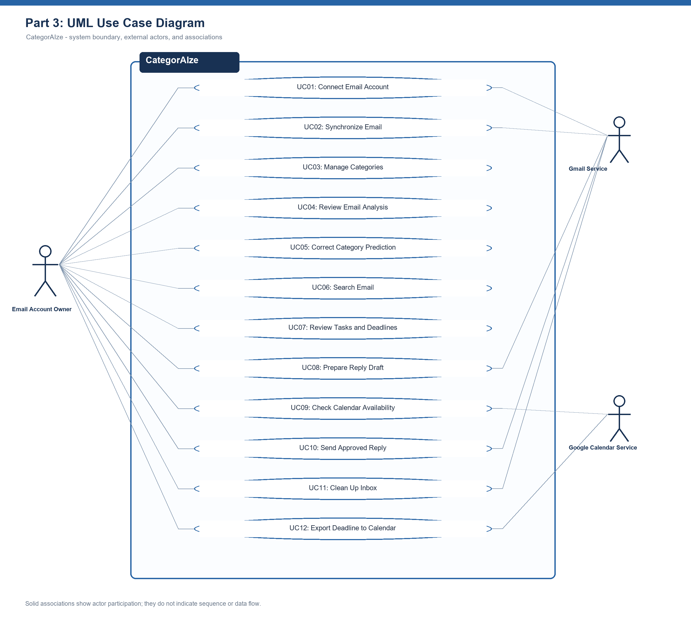

# Laboratory Activity 6: Use Case Diagram Development

**Course:** Software Engineering 1  
**Project:** CategorAIze — Intelligent Email Organization Assistant  
**Coverage:** Parts 1, 2, and 3

## Part 1: Project Scope and Actor Identification

### Project purpose and scope

CategorAIze helps email account owners organize and prioritize messages, understand email content, and act on tasks and deadlines. It supports English and Filipino/Taglish email analysis, user-defined categories, classification corrections, email search, reply preparation, inbox cleanup, and Google Calendar integration.

The system boundary includes the CategorAIze web application, its background processing, database, and internal NLP service. Gmail and Google Calendar are external services. This model follows the project's documented target workflows; it does not claim that every planned capability is already implemented or that the instructor has approved this scope.

**In scope:** account connection, email synchronization, category management, analysis review, prediction feedback, search, task/deadline review, draft preparation, calendar availability, explicitly approved sending, inbox cleanup, and confirmed calendar export.

**Out of scope:** deployment administration, model-training operations, billing, and inherited features unrelated to the core CategorAIze workflows. No administrator role is assumed because the selected workflows do not establish a separate administrator-facing service.

### Actor inventory

| ID | Actor | Description | Main interaction with the system |
| --- | --- | --- | --- |
| A1 | Email Account Owner | Primary human actor who connects and manages their own mailbox. | Connects an account, reviews and organizes email, corrects predictions, searches messages, manages tasks, prepares replies, approves sending, cleans the inbox, and exports calendar events. |
| A2 | Gmail Service | External email and OAuth service used by the selected project workflows. | Authorizes mailbox access, supplies messages and updates, stores drafts, sends approved replies, and applies requested mailbox changes. |
| A3 | Google Calendar Service | External calendar service linked with the owner's consent. | Supplies availability and creates events after the owner confirms an export. |

The NLP service and database are internal components, not actors. Email senders are not actors in this diagram because their messages reach CategorAIze through Gmail; they do not directly operate the selected system services.

## Part 2: Use Case Identification

| **Actor** | **Use Case** | **Purpose** |
| --------------- | ------------------ | -------------------------------------------------- |
| Email Account Owner | Connect Email Account | Allows the owner to sign in and authorize CategorAIze to access Gmail. |
| Gmail Service | Connect Email Account | Provides OAuth authorization and mailbox access. |
| Email Account Owner | Synchronize Email | Allows the owner to retrieve new and updated messages for processing and review. |
| Gmail Service | Synchronize Email | Supplies new and updated messages from the connected mailbox. |
| Email Account Owner | Manage Categories | Allows the owner to create, edit, activate, or remove categories and set classification preferences. |
| Email Account Owner | Review Email Analysis | Allows the owner to inspect category predictions, priority explanations, summaries, actions, and deadlines when available. |
| Email Account Owner | Correct Category Prediction | Allows the owner to submit an explicit correction using an existing category to improve personalized predictions. |
| Email Account Owner | Search Email | Allows the owner to find relevant messages using semantic search and available filters. |
| Email Account Owner | Review Tasks and Deadlines | Allows the owner to review extracted actions, approaching deadlines, and dates that need attention. |
| Email Account Owner | Prepare Reply Draft | Allows the owner to generate and edit a contextual reply before saving it as a Gmail draft. |
| Gmail Service | Prepare Reply Draft | Stores the reply in Gmail Drafts when requested. |
| Email Account Owner | Check Calendar Availability | Allows the owner to consult calendar availability for scheduling or a reply. |
| Google Calendar Service | Check Calendar Availability | Supplies the connected calendar's availability information. |
| Email Account Owner | Send Approved Reply | Allows the owner to send a reviewed reply after explicitly confirming it. |
| Gmail Service | Send Approved Reply | Sends the reply after receiving the owner's confirmed request. |
| Email Account Owner | Clean Up Inbox | Allows the owner to archive selected messages, unsubscribe from unwanted mail, or configure cold-outreach blocking. |
| Gmail Service | Clean Up Inbox | Applies requested mailbox changes and supports unsubscribe actions. |
| Email Account Owner | Export Deadline to Calendar | Allows the owner to confirm a reviewed deadline before creating a calendar event. |
| Google Calendar Service | Export Deadline to Calendar | Creates the event after the owner confirms its details. |

**General preconditions:** UC02–UC12 require an authenticated owner and a connected mailbox. Calendar operations additionally require a connected calendar and appropriate authorization. Analysis results must distinguish available outputs from unavailable model capabilities.

## Part 3: UML Use Case Diagram Construction

### Diagram explanation

- The rectangle labeled **CategorAIze** is the system boundary.
- All three actors are outside it, and all twelve use cases appear as ovals inside it.
- Solid association lines indicate participation, not execution order or data flow. The email account owner participates in all twelve use cases, including email synchronization that may also run in the background after connection.
- Gmail participates in UC01, UC02, UC08, UC10, and UC11. Google Calendar participates in UC09 and UC12.
- No `<<include>>` or `<<extend>>` relationships are asserted. These services have their own user goals, and the selected scope does not establish a mandatory shared sub-use-case or an optional extension at a defined extension point. Authentication is documented as a precondition for protected operations.
- The internal NLP service supports analysis and feedback within CategorAIze, so it is not drawn as an external actor.

### Project references

- [CategorAIze implementation plan](../plans/categoraiize-implementation-plan.md): target architecture and product workflows.
- [NLP incremental implementation plan](../categoraize-nlp-incremental-implementation.md): verified feedback, service boundaries, and capability availability.
- [NLP training phases](../categoraize-nlp-training-phases.md): classification, correction, and action/deadline extraction responsibilities.

The consolidated PDF contains Parts 1–3. Peer review, revisions, and presentation are reserved for the later laboratory parts.
